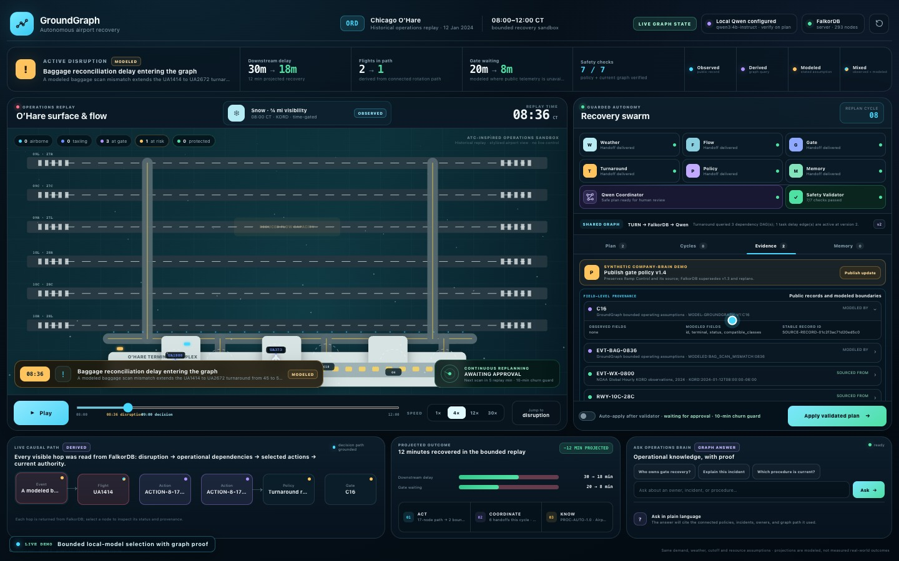
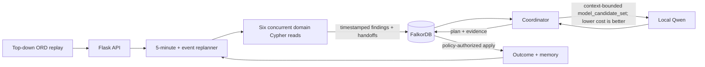

# GroundGraph

**A graph-native airport operations recovery command center.** GroundGraph continuously replays a bounded winter morning at Chicago O'Hare, runs six specialist Cypher reads against FalkorDB, builds materially different recovery strategies from the connected state, lets a local model select only from a context-bounded shortlist of the safe non-dominated ranking, applies plans under current synthetic policy, and recalls modeled outcomes only when the disruption context matches.

GroundGraph enters all three 2026 FalkorDB GraphRAG Hackathon tracks:

1. **Agents That Act on Connected Data**
2. **Agent Memory and Coordination**
3. **Company Brain**

[](demo/groundgraph-demo.mp4)

**[Watch the GroundGraph demo](demo/groundgraph-demo.mp4)** — full FalkorDB server through Podman, local Qwen selection, graph-coordinated specialists, guarded application, persistent memory, and live policy supersession.

The [recording manifest](demo/groundgraph-demo.manifest.json) pins the source commit, runtime health, scene timings, media properties, and SHA-256 checksum for the final 3:49 demo.

This repository is the event-period implementation for the [FalkorDB GraphRAG Hackathon](https://www.wemakedevs.org/hackathons/falkordb) and follows its [submission rules](https://www.wemakedevs.org/hackathons/falkordb/rules).

The project is an airport-operations research replay. It does not issue air-traffic-control clearances, connect to live airport systems, or claim measured historical savings.

## The demonstration

The four-hour replay covers six connected United flights from 08:00–12:00 CST on January 12, 2024.

- Public BTS schedule fields, time-gated NOAA weather, and FAA runway facts provide the historical context.
- A modeled 08:36 baggage-reconciliation delay propagates into the `UA1414-IN → UA2672-OUT` rotation.
- An observed 09:04 NOAA weather update and a modeled 09:12 runway event trigger later planning cycles.
- Weather, Flow, Gate, Turnaround, Policy, and Memory specialists execute six domain-specific Cypher reads concurrently. Their start/end timestamps, evidence IDs, input graph version, findings, and handoffs are persisted before coordination.
- The planner constructs `FLOW_BALANCE`, `GATE_SWAP`, and `TURNAROUND_RECOVERY` as different two-action bundles. Benefit and operational burden come from the active graph neighborhood; `cost_score` is lower-is-better. The server first computes the full safe non-dominated `safe_candidate_set`, then forms `model_candidate_set` from candidates within 4 cost points of its leader for a `TURNAROUND` event class or within 8 for other event classes.
- Local `qwen3:4b-instruct` receives only `model_candidate_set` and may select one ID from that shortlist. The same IDs are stored in `ModelRun.allowlisted_candidate_ids`; invalid or unavailable model output uses a labeled deterministic fallback.
- The interface toggle changes server-side autonomy through `/api/autonomy`. A current policy may authorize bounded auto-application; supervised mode retains the same seven application checks.
- Each applied modeled outcome preserves a full `DecisionEpisode → Plan → Outcome ← Memory` lineage and the same six unique `AgentRun → Finding → Handoff` chains consumed by that `DecisionEpisode`. Those records survive replay reset and application restart while the FalkorDB volume is retained. The memory can influence a later ranking only when event class and connected flights, rotations, or resources match.

Source fields and replay assumptions are classified as **Observed**, **Derived**, or **Modeled**. Flights, runways, gates, events, and turnarounds carry stable record IDs and connect through `SOURCED_FROM` or `MODELED_BY` to `SourceRecord` evidence. Mixed records have field-level boundaries in [Data provenance](docs/data-provenance.md), and all counterfactual improvements are described as projected under the replay assumptions. The exact selected BTS, NOAA, and FAA rows are checked into the [public evidence pack](data/public/README.md) with pinned hashes and reproducible extraction instructions.

## Why FalkorDB is essential

FalkorDB is the application's operational state, coordination bus, policy store, and memory. It holds:

```text
event → affected flight / runway / turnaround task
flight → RECOVERED_BY → action → USES_RESOURCE / REORDERS / PROTECTS
action → AUTHORIZED_BY → policy → procedure → document / owner / role
agent run → finding → handoff → coordinator episode → tool calls
episode → selected plan → outcome ← context-matched memory → later episode
entity → SOURCED_FROM / MODELED_BY → source record → source
policy → procedure → source document → owner team → responsible role
```

In the judged server mode, loss of FalkorDB makes the replay API unavailable: replanning, policy authorization, handoffs, and memory cannot continue. There is no secondary operational database that can silently replace it.

## Three-track proof

| Track | Visible behavior | Graph evidence |
|---|---|---|
| **Agents That Act on Connected Data** | Three distinct graph-derived strategies, a full safe non-dominated ranking, context-bounded model shortlist, lower-is-better cost scoring, and guarded application. The visible causal path is rebuilt only from persisted relationships. | `safe_candidate_set`; `model_candidate_set`; `ModelRun.allowlisted_candidate_ids`; `Event-[:AFFECTS|CONSTRAINS|DELAYS]→…`; `Flight-[:RECOVERED_BY]→Action`; `Action-[:USES_RESOURCE|REORDERS|PROTECTS|AUTHORIZED_BY]→…`; applied `Outcome`. |
| **Agent Memory and Coordination** | Six specialists run real concurrent domain Cypher reads, deliver timestamped versioned handoffs, and replan every five replay minutes and on events. An applied episode restores the same six unique specialist chains alongside its context-matched memory and full decision lineage. | `AgentRun → Finding → Handoff`; `DecisionEpisode-[:CONSUMED_HANDOFF]→Handoff`; `DecisionEpisode → Plan → Outcome ← Memory`; later matching `DecisionEpisode-[:RECALLED]→Memory`. |
| **Company Brain** | Plain-language questions route to ownership, incident, current-policy, or supersession traversals and return cited graph evidence. Superseding policy increments graph state and triggers replanning. | `Policy → ProcedureVersion → SourceDocument/Team/Role`, `Incident → Event/Flight/Team/Role`, and `SUPERSEDES` history. |

The complete acceptance matrix is in [Three-track coverage](docs/track-coverage.md). Copy-paste graph queries live in [`cypher/`](cypher/).

The bundled [`mcp_server.py`](mcp_server.py) exposes six allowlisted stdio tools: `inspect_disruption`, `get_agent_handoffs`, `get_coordinator_trace`, `recall_episode`, `get_current_policy`, and `validate_candidate`. This optional integration surface returns graph evidence and keeps plan execution behind the deterministic application guard.

## Architecture



The judged path runs the full official `docker.io/falkordb/falkordb:6.0.0` server locally through Podman. The submission video, screenshots, and verification use `runtime_mode: server`. FalkorDBLite is available only as a non-judged development fallback.

After the container image, Python packages, and Ollama model are installed, the checked-in replay runs locally without calling external data or model APIs.

## Quick start on macOS

This project uses **Podman only** for its container runtime. It neither installs nor uses Docker Desktop or Colima.

```bash
brew install python@3.12 podman ollama
ollama serve                                # keep this terminal open if Ollama is not a service
```

In a new terminal:

```bash
git clone <PUBLIC_REPOSITORY_URL> groundgraph
cd groundgraph
make setup
make pull-model
make start
```

Open [http://127.0.0.1:5050](http://127.0.0.1:5050). The first `make start` initializes a small Podman VM, pulls official FalkorDB, waits for database health, and starts the app. FalkorDB Browser is at [http://127.0.0.1:3000](http://127.0.0.1:3000).

Podman chooses the machine provider supported by the host and installed Podman version. GroundGraph does not require a particular provider; use the default unless your Podman installation documents otherwise.

On Linux, install the same prerequisites with your distribution's package manager; Podman normally runs natively there, so `make start` uses it without creating a virtual machine.

Verify the judged runtime from another terminal:

```bash
make verify
make demo-check
```

`make verify` requires the API, graph name, database endpoint, loaded FalkorDB graph module, and installed Ollama model to agree. `make demo-check` additionally verifies the exact official container image and performs a real structured inference with local Qwen. Run both before presenting. `/api/health` must return `"runtime_mode": "server"` before the demo claims the official server.

Complete setup and troubleshooting instructions are in [Local setup](docs/local-setup.md).

## Useful controls

```bash
make start          # official FalkorDB through Podman + local app
make start-lite     # non-judged development fallback
make verify         # read-only API/database/model checks
make demo-check     # strict official-image + live-model readiness check
make audit          # offline package, provenance, and documentation checks
make test           # install optional test dependencies if needed, then run tests
make logs           # official FalkorDB container logs
make down           # stop the database container
```

Runtime configuration lives in [`.env.example`](.env.example). Defaults enable local Qwen and policy-authorized bounded autopilot. Set `GROUNDGRAPH_AUTO_APPLY=0` for supervised click-to-apply mode or `GROUNDGRAPH_ENABLE_LLM=0` to exercise the labeled deterministic path.

`make setup` installs only the judged full-server dependencies. FalkorDBLite and pytest are isolated in optional dependency files and are installed automatically when `make start-lite` or `make test` needs them. The repository intentionally uses a direct Podman command for FalkorDB and a host-local Flask process; no Compose provider, Docker Desktop, or Colima is part of the supported path.

## API surface

| Method | Endpoint | Purpose |
|---|---|---|
| `GET` | `/api/health` | Runtime mode, graph counts, state version, model configuration. |
| `GET` | `/api/snapshot` | Complete judge-facing replay projection. |
| `GET` | `/api/replanning` | Agents, timestamped handoffs, contextual memory, plan, and cycle history. |
| `GET` / `POST` | `/api/company-brain` | Route a question to ownership, incident, current-policy, or supersession evidence. |
| `POST` | `/api/replan/tick` | Advance replay time and trigger due event/periodic cycles. |
| `POST` | `/api/analyze` | Trigger a manual audit cycle. |
| `POST` | `/api/apply` | Apply a supervised plan with version checks. |
| `POST` | `/api/autonomy` | Enable or disable server-side bounded auto-application. |
| `POST` | `/api/policies/supersede` | Replace policy knowledge and immediately replan. |
| `POST` | `/api/reset` | Reset replay state, optionally retaining episodic memory. |

## Repository guide

| Path | Contents |
|---|---|
| `app.py`, `engine.py` | API, graph adapter, replay, agents, planning, memory, and policy logic. |
| `mcp_server.py` | Allowlisted, read-only MCP tools plus candidate validation. |
| `static/` | Top-down command-center interface. |
| `data/scenario.json` | Bounded replay fixture. |
| `data/provenance.json` | Machine-readable source and assumption contract. |
| `data/public/` | Minimal public-source extracts and the hash-verifying reproduction tool. |
| `knowledge/` | Versioned synthetic SOP, incident, shift handoff, teams, roles, and import manifest. |
| `cypher/` | Essential track-defining graph queries. |
| `docs/` | Architecture, graph model, setup, track evidence, demo, disclosure, and checklist. |
| `scripts/` | Podman/FalkorDB startup and read-only release verification. |

## Evidence and disclosure

- [Architecture](docs/architecture.md)
- [Graph model](docs/graph-model.md)
- [Data provenance](docs/data-provenance.md)
- [AI use disclosure](docs/ai-disclosure.md)
- [Judge demo script](docs/demo-script.md)
- [Submission copy](docs/submission-copy.md)
- [Submission checklist](docs/submission-checklist.md)

OpenAI Codex assisted development and documentation. The product coordinator is a separate local Qwen runtime constrained to the server-generated `model_candidate_set`. Full details are in the disclosure above.
