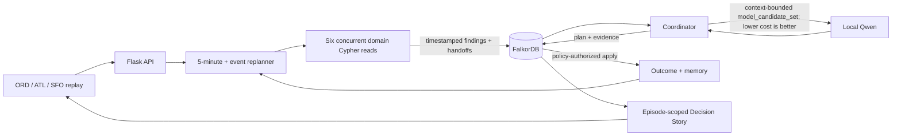

# GroundGraph

**A graph-native airport operations recovery command center.** GroundGraph switches between bounded historical-demand replays for Chicago O'Hare, Atlanta, and San Francisco. For every decision it runs six specialist Cypher reads against FalkorDB, builds materially different recovery strategies from the connected state, lets a local model compare only server-approved safe candidates, applies plans under current synthetic policy, and recalls modeled outcomes only when the disruption context matches.

GroundGraph enters all three 2026 FalkorDB GraphRAG Hackathon tracks:

1. **Agents That Act on Connected Data**
2. **Agent Memory and Coordination**
3. **Company Brain**

[](demo/groundgraph-demo.mp4)

**[Watch the GroundGraph demo](demo/groundgraph-demo.mp4)** — full FalkorDB server through Podman, local Qwen selection, graph-coordinated specialists, guarded application, persistent memory, and live policy supersession.

The [recording manifest](demo/groundgraph-demo.manifest.json) records the source commit, runtime health, scene timings, media properties, and SHA-256 checksum for the packaged demo.

This repository is the event-period implementation for the [FalkorDB GraphRAG Hackathon](https://www.wemakedevs.org/hackathons/falkordb) and follows its [submission rules](https://www.wemakedevs.org/hackathons/falkordb/rules).

The project is an airport-operations research replay. It does not issue air-traffic-control clearances, connect to live airport systems, or claim measured historical savings.

## The demonstration

The airport selector activates one independent four-hour, six-flight scenario and its own FalkorDB graph:

| Airport | Replay window | Historical context | Modeled operating pressure |
|---|---|---|---|
| **ORD** | January 12, 2024 · 08:00–12:00 CST | BTS schedule fields, time-gated NOAA KORD weather, and FAA runway identity/length. | Gates, rotation availability at decision time, baggage exception, runway inspection, capacity effects, policy, actions, and outcomes. |
| **ATL** | January 12, 2024 · 14:00–18:00 EST | BTS schedule fields, time-gated NOAA KATL weather, and FAA runway identity/length. | Gates, rotations at decision time, weather-to-capacity effects, baggage exception, policy, actions, and outcomes. |
| **SFO** | January 6, 2024 · 13:00–17:00 PST | BTS schedule fields, time-gated NOAA KSFO weather, and FAA runway identity/length. | Gates, rotations at decision time, wind/rain capacity effects, baggage exception, policy, actions, and outcomes. |

These are historical-demand replays, not reconstructions of actual airport decisions. The selected dates, schedule identities/times, weather reports, and runway identities/lengths establish context; gates, disruptions beyond the named weather observations, resource state, causal effects, recovery actions, and results are replay assumptions.

- The **Decision Story** is scoped to one persisted `DecisionEpisode`. It presents the trigger, why action is needed now, all six specialist findings, the safe candidates Qwen received, its selection, seven deterministic application checks, the projected outcome, and the next scan without combining records from different cycles.
- Weather, Flow, Gate, Turnaround, Policy, and Memory specialists execute six domain-specific Cypher reads concurrently. Their start/end timestamps, evidence IDs, input graph version, findings, and handoffs are persisted before coordination.
- The planner constructs `FLOW_BALANCE`, `GATE_SWAP`, and `TURNAROUND_RECOVERY` as different two-action bundles. Benefit and operational burden come from the active graph neighborhood; `cost_score` is lower-is-better. The server first computes the full safe non-dominated `safe_candidate_set`, then forms `model_candidate_set` from candidates within 18 cost points of its leader for a `TURNAROUND` event class or within 8 for other event classes.
- Local `qwen3:4b-instruct` receives only `model_candidate_set` and may select one ID from that shortlist. The same IDs are stored in `ModelRun.allowlisted_candidate_ids`; invalid or unavailable model output uses a labeled deterministic fallback.
- Before application, the server recomputes seven checks: same current graph version, current policy authority, current replay knowledge, required targets and graph links, execution-freeze clearance, minimum projected benefit, and the churn guard. The interface toggle changes server-side autonomy through `/api/autonomy`; supervised mode uses the same checks.
- Each applied modeled outcome preserves a full `DecisionEpisode → Plan → Outcome ← Memory` lineage and the same six unique `AgentRun → Finding → Handoff` chains consumed by that `DecisionEpisode`. Those records survive replay reset and application restart while the FalkorDB volume is retained. The memory can influence a later ranking only when event class and connected flights, rotations, or resources match.

Source fields and replay assumptions are classified as **Observed**, **Derived**, or **Modeled**. Flights, runways, gates, events, and turnarounds carry stable record IDs and connect through `SOURCED_FROM` or `MODELED_BY` to `SourceRecord` evidence. Mixed records have field-level boundaries in [Data provenance](docs/data-provenance.md), and all counterfactual improvements are described as projected under the replay assumptions. The default ORD scenario has exact selected BTS, NOAA, and FAA rows in the [public evidence pack](data/public/README.md), with pinned hashes and reproducible extraction instructions. The ATL and SFO packages record source URLs, row keys, observed/modeled field lists, and source-file digests, but their selected raw rows are not checked into that evidence pack.

## Factual ORD shadow test and multi-day benchmark

GroundGraph also includes a separate 24-hour factual backtest for **ORD on July 27, 2026**. It uses 2,164 public BTS scheduled segments and realized outcomes plus 53 archived KORD METAR observations. July 2026 was the latest complete public BTS monthly delay archive available when the pack was built, so this is a reproducible historical day rather than a replication of yesterday.

Every hour, six specialists execute fixed allowlisted Cypher reads for weather, demand, arrivals, departures, matured disruptions, and forecast memory. Their `AgentRun → Finding → Handoff` records are persisted in FalkorDB and re-read by the coordinator. The runtime saves four next-hour aggregate forecasts for comparison: schedule baseline, recent observed flow, weather stress, and a frozen June-trained historical analogue. The historical analogue supplies the numerical default; local Qwen can verify its exact allowlisted ID and explain it, but cannot alter its values or invent a forecast.

Schedule is available from the start, METARs arrive at their observation times, and a movement timestamp and endpoint delay enter agent state only when the recorded ORD timestamp has passed. Eventual cancellation and diversion flags never enter live features; those flags and unresolved post-midnight labels remain sealed until aggregate end-of-day settlement, after the final forecast. The mode reports hourly cohort-mean delay error plus cancellation, disruption, and delay-band metrics. Its schedule baseline assumes zero mean delay and ignores weather and recent flow.

A separate chronological benchmark evaluates **every reconstructable ORD day from July 2–31**: 30 days, 638 scored hourly windows, and 54,774 target movements across 10 normal, 12 elevated, and 8 severe days. A historical-analogue candidate calibrated and validated on June achieves 19.07-minute delay MAE, 3.96-percentage-point cancellation MAE, and 9.42-percentage-point disruption MAE; the schedule-only baseline's delay MAE is 34.92 minutes. July labels do not enter parameter fitting, scaling, validation loss, or neighbor selection, although feature and model-family design followed inspection of the July 27 showcase. The batch evaluator is graph-free for speed, while the selected-day runtime separately proves FalkorDB persistence and agent coordination.

The API reports this boundary explicitly: `agent_future_outcomes_visible` remains `false`, raw sealed archive rows are never returned, and `archive_aggregate_visible` becomes `true` only at 24:00 when the evaluator produces aggregate scoring.

The backtest uses a dedicated graph that is cleared and rebuilt when the runtime loads. Its source packs are reproducible, but in-progress backtest state is not claimed to persist across application restarts. Neither evaluation is a causal intervention or saved-minutes claim. See [ORD real-day factual shadow test](docs/real-day-backtest.md) for the runtime boundary and [ORD multi-day factual benchmark](docs/multiday-benchmark.md) for the cohort, chronological split, full result tables, model audit, and limitations.

## Why FalkorDB is essential

FalkorDB is the application's operational state, coordination bus, policy store, and memory. It holds:

```text
event → affected flight / runway / turnaround task
flight → RECOVERED_BY → action → USES_RESOURCE / REORDERS / PROTECTS
action → AUTHORIZED_BY → policy → procedure → document / owner / role
agent run → finding → handoff → coordinator episode → tool calls
episode → selected plan → outcome ← context-matched memory → later episode
entity → SOURCED_FROM / MODELED_BY → source record → source
policy → procedure → source document → owner team → responsible role
```

In the judged server mode, loss of FalkorDB returns a structured `503 GRAPH_UNAVAILABLE`, freezes the replay, disables operational controls, and marks the interface read-only. Replanning, policy authorization, handoffs, and memory cannot continue, and there is no secondary operational database that can silently replace it. After FalkorDB is restored, the health pulse reloads genuine graph state before re-enabling controls.

## Three-track proof

| Track | Visible behavior | Graph evidence |
|---|---|---|
| **Agents That Act on Connected Data** | One episode-scoped Decision Story shows three graph-derived strategies, the safe ranking, the model shortlist, Qwen's choice, seven fresh guards, and the projected result. The visible causal path is rebuilt only from persisted relationships. | `safe_candidate_set`; `model_candidate_set`; `ModelRun.allowlisted_candidate_ids`; `Event-[:AFFECTS|CONSTRAINS|DELAYS]→…`; `Flight-[:RECOVERED_BY]→Action`; `Action-[:USES_RESOURCE|REORDERS|PROTECTS|AUTHORIZED_BY]→…`; applied `Outcome`. |
| **Agent Memory and Coordination** | Six specialists run real concurrent domain Cypher reads, deliver timestamped versioned handoffs, and replan every five replay minutes and on events. An applied episode restores the same six unique specialist chains alongside its context-matched memory and full decision lineage. | `AgentRun → Finding → Handoff`; `DecisionEpisode-[:CONSUMED_HANDOFF]→Handoff`; `DecisionEpisode → Plan → Outcome ← Memory`; later matching `DecisionEpisode-[:RECALLED]→Memory`. |
| **Company Brain** | Plain-language questions route to ownership, incident, current-policy, or supersession traversals and return cited graph evidence. Superseding policy increments graph state and triggers replanning. | `Policy → ProcedureVersion → SourceDocument/Team/Role`, `Incident → Event/Flight/Team/Role`, and `SUPERSEDES` history. |

The complete acceptance matrix is in [Three-track coverage](docs/track-coverage.md). Copy-paste graph queries live in [`cypher/`](cypher/).

The bundled [`mcp_server.py`](mcp_server.py) exposes six allowlisted stdio tools: `inspect_disruption`, `get_agent_handoffs`, `get_coordinator_trace`, `recall_episode`, `get_current_policy`, and `validate_candidate`. Handoff and coordinator-trace reads resolve one exact `episode_id`; cycle-only calls select the newest episode at that cycle for legacy callers, so replay resets cannot mix two runs with the same cycle number. This optional integration surface returns graph evidence and keeps plan execution behind the deterministic application guard.

## Architecture



The judged path runs the full official `docker.io/falkordb/falkordb:6.0.0` server locally through Podman. On macOS, the bootstrap creates an AppleHV Podman machine when no machine exists, so the judged path does not require Docker Desktop or Colima. The submission video, screenshots, and verification use `runtime_mode: server`. FalkorDBLite is available only as a non-judged development fallback.

After the container image, Python packages, and Ollama model are installed, the checked-in replay runs locally without calling external data or model APIs.

## Quick start on macOS

This project uses **Podman only** for its container runtime. It neither installs nor uses Docker Desktop or Colima.

```bash
brew install python@3.12 podman ollama
ollama serve                                # keep this terminal open if Ollama is not a service
```

In a new terminal:

```bash
git clone https://github.com/SuVI3010/groundgraph.git groundgraph
cd groundgraph
make setup
make pull-model
make start
```

Open [http://127.0.0.1:5050](http://127.0.0.1:5050). The first `make start` initializes a small Podman VM, pulls official FalkorDB, waits for database health, and starts the app. FalkorDB Browser is at [http://127.0.0.1:3000](http://127.0.0.1:3000).

On macOS, `make start` creates an AppleHV-backed Podman machine when none exists, then starts the official FalkorDB container. If a Podman machine is already configured, it uses the default Podman connection for that machine.

On Linux, install the same prerequisites with your distribution's package manager; Podman normally runs natively there, so `make start` uses it without creating a virtual machine.

Verify the judged runtime from another terminal:

```bash
make verify
make demo-check
```

`make verify` requires the API, graph name, database endpoint, loaded FalkorDB graph module, and installed Ollama model to agree. `make demo-check` additionally verifies the exact official container image and performs a real structured inference with local Qwen. Run both before presenting. `/api/health` must return `"runtime_mode": "server"` before the demo claims the official server.

Complete setup and troubleshooting instructions are in [Local setup](docs/local-setup.md).

## Useful controls

```bash
make start          # official FalkorDB through Podman + local app
make start-lite     # non-judged development fallback
make verify         # read-only API/database/model checks
make demo-check     # strict official-image + live-model readiness check
make audit          # offline package, provenance, and documentation checks
make test           # install optional test dependencies if needed, then run tests
make logs           # official FalkorDB container logs
make down           # stop the database container
```

Runtime configuration lives in [`.env.example`](.env.example). Defaults enable local Qwen and policy-authorized bounded autopilot. Set `GROUNDGRAPH_AUTO_APPLY=0` for supervised click-to-apply mode or `GROUNDGRAPH_ENABLE_LLM=0` to exercise the labeled deterministic path.

`make setup` installs only the judged full-server dependencies. FalkorDBLite and pytest are isolated in optional dependency files and are installed automatically when `make start-lite` or `make test` needs them. The repository intentionally uses a direct Podman command for FalkorDB and a host-local Flask process; no Compose provider, Docker Desktop, or Colima is part of the supported path.

## API surface

| Method | Endpoint | Purpose |
|---|---|---|
| `GET` | `/api/health` | Runtime mode, graph counts, state version, model configuration. |
| `GET` | `/api/snapshot` | Complete judge-facing replay projection. |
| `GET` | `/api/decision-story` | One complete trigger-to-outcome explanation, optionally selected by `episode_id`. |
| `GET` | `/api/airports` | Airport selector metadata and truth-boundary notes for ORD, ATL, and SFO. |
| `POST` | `/api/airports/select` | Activate an airport replay by code and return its graph snapshot. |
| `GET` | `/api/scenarios` | Scenario registry, runtime graph names, and load status. |
| `POST` | `/api/scenarios/select` | Activate a registered scenario by ID. |
| `GET` | `/api/replanning` | Agents, timestamped handoffs, contextual memory, plan, and cycle history. |
| `GET` / `POST` | `/api/company-brain` | Route a question to ownership, incident, current-policy, or supersession evidence. |
| `POST` | `/api/replan/tick` | Advance replay time and trigger due event/periodic cycles. |
| `POST` | `/api/analyze` | Trigger a manual audit cycle. |
| `POST` | `/api/apply` | Apply a supervised plan with version checks. |
| `POST` | `/api/autonomy` | Enable or disable server-side bounded auto-application. |
| `POST` | `/api/policies/supersede` | Replace policy knowledge and immediately replan. |
| `POST` | `/api/reset` | Reset replay state, optionally retaining episodic memory. |
| `GET` | `/api/backtests` | List factual historical backtest packs and active state. |
| `GET` | `/api/backtests/health` | Validate the active factual replay and its dedicated FalkorDB graph. |
| `POST` | `/api/backtests/select` | Load or reset an isolated factual backtest graph. |
| `POST` | `/api/backtests/tick` | Advance the factual replay clock. |
| `GET` | `/api/backtests/results` | Return paired forecasts, observed evaluations, and cumulative accuracy. |

## Repository guide

| Path | Contents |
|---|---|
| `app.py`, `engine.py` | API, graph adapter, replay, agents, planning, memory, and policy logic. |
| `backtest.py` | Leakage-resistant factual shadow runner, six graph specialists, model-bounded forecast choice, and evaluator. |
| `mcp_server.py` | Allowlisted, read-only MCP tools plus candidate validation. |
| `static/` | Airport view, episode-scoped Decision Story, controls, and evidence interface. |
| `data/scenario-registry.json` | ORD, ATL, and SFO scenario metadata, graph names, truth notes, and package hashes. |
| `data/scenario.json`, `data/scenarios/` | The default ORD replay and additional ATL/SFO replay packages. |
| `data/provenance.json` | Machine-readable source and assumption contract for the default ORD evidence pack. |
| `data/public/` | Minimal ORD public-source extracts and the hash-verifying reproduction tool. |
| `data/backtests/` | Reproducible historical backtest packs with separated schedule, time-gated weather, sealed ground truth, and source manifests. |
| `analysis/ord-july-2026-benchmark/` | Machine-readable 30-day benchmark, per-day metrics, hourly results, and independent weather-source check. |
| `knowledge/` | Versioned synthetic SOP, incident, shift handoff, teams, roles, and import manifest. |
| `cypher/` | Essential track-defining graph queries. |
| `docs/` | Architecture, graph model, setup, track evidence, demo, disclosure, and checklist. |
| `scripts/` | Podman/FalkorDB startup and read-only release verification. |

## Evidence and disclosure

- [Architecture](docs/architecture.md)
- [Graph model](docs/graph-model.md)
- [Data provenance](docs/data-provenance.md)
- [ORD real-day factual shadow test](docs/real-day-backtest.md)
- [ORD multi-day factual benchmark](docs/multiday-benchmark.md)
- [AI use disclosure](docs/ai-disclosure.md)
- [Judge demo script](docs/demo-script.md)
- [Submission copy](docs/submission-copy.md)
- [Submission checklist](docs/submission-checklist.md)

OpenAI Codex assisted development and documentation. The product coordinator is a separate local Qwen runtime constrained to the server-generated `model_candidate_set`. Full details are in the disclosure above.
