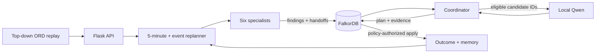

# GroundGraph

**A graph-native airport operations recovery command center.** GroundGraph continuously replays a bounded winter morning at Chicago O'Hare, coordinates six specialist agents through FalkorDB, lets a local model select only from replay-eligible recovery candidates, applies plans under current synthetic policy, and remembers modeled outcomes for the next disruption.

GroundGraph enters all three 2026 FalkorDB GraphRAG Hackathon tracks:

1. **Agents That Act on Connected Data**
2. **Agent Memory and Coordination**
3. **Company Brain**

[](demo/groundgraph-demo.mp4)

**[Watch the 2:43 judged-runtime demo](demo/groundgraph-demo.mp4)** — full FalkorDB server through Podman, local Qwen selection, six graph-coordinated specialists, guarded application, persistent memory, and live policy supersession.

This repository is the event-period implementation for the [FalkorDB GraphRAG Hackathon](https://www.wemakedevs.org/hackathons/falkordb) and follows its [submission rules](https://www.wemakedevs.org/hackathons/falkordb/rules).

The project is an airport-operations research replay. It does not issue air-traffic-control clearances, connect to live airport systems, or claim measured historical savings.

## The demonstration

The four-hour replay covers six connected United flights from 08:00–12:00 CST on January 12, 2024.

- Public BTS schedule fields, time-gated NOAA weather, and FAA runway facts provide the historical context.
- A modeled 08:36 baggage-reconciliation delay propagates into the `UA1414-IN → UA2672-OUT` rotation.
- An observed 09:04 NOAA weather update and a modeled 09:12 runway event trigger later planning cycles.
- Weather, Flow, Gate, Turnaround, Policy, and Memory agents write findings and handoffs into FalkorDB.
- Local `qwen3:4b-instruct` selects one ID from the deterministically validated candidate set. Invalid or unavailable model output uses a labeled fallback.
- A current policy can authorize bounded autopilot; supervised mode remains available.
- Applied modeled outcomes become persistent graph memory, survive replay and application restarts while the FalkorDB volume is retained, and can adjust later candidate rankings.

Source fields and replay assumptions are classified as **Observed**, **Derived**, or **Modeled**. Mixed records have field-level boundaries in [Data provenance](docs/data-provenance.md), and all counterfactual improvements are described as projected under the replay assumptions.

## Why FalkorDB is essential

FalkorDB is the application's operational state, coordination bus, policy store, and memory. It holds:

```text
event → affected flight → next rotation → resources
agent run → finding → handoff → coordinator episode
episode → selected plan → actions → current policy evidence
plan → outcome ← episodic memory → later episode
policy → procedure → source document → owner team → responsible role
```

In the judged server mode, loss of FalkorDB makes the replay API unavailable: replanning, policy authorization, handoffs, and memory cannot continue. There is no secondary operational database that can silently replace it.

## Three-track proof

| Track | Visible behavior | Graph evidence |
|---|---|---|
| **Agents That Act on Connected Data** | Event-driven causal path, local-model candidate selection, deterministic checks, and policy-authorized application. | `Event → Flight → next Flight`; the event's `Scenario ← DecisionEpisode → Plan → Action → Policy` decision path; applied `Outcome`. |
| **Agent Memory and Coordination** | Six specialists run concurrently, deliver versioned handoffs, and replan every five replay minutes and on events. Memory survives a replay reset and a previous modeled outcome can alter a later score. | `AgentRun → Finding → Handoff`; `Memory → Outcome`; later `DecisionEpisode → Memory`. |
| **Company Brain** | Each action shows its current rule, source excerpt, owner, role, version, and freshness status. Superseding policy increments graph state and triggers replanning. | `Policy → ProcedureVersion → SourceDocument/Team/Role`, with `SUPERSEDES` history. |

The complete acceptance matrix is in [Three-track coverage](docs/track-coverage.md). Copy-paste graph queries live in [`cypher/`](cypher/).

The bundled [`mcp_server.py`](mcp_server.py) exposes five allowlisted stdio tools for disruption inspection, handoff retrieval, episode recall, current-policy lookup, and candidate validation. This optional integration surface returns graph evidence and keeps plan execution behind the deterministic application guard.

## Architecture



The judged path runs the full official `docker.io/falkordb/falkordb:6.0.0` server locally through Podman. The submission video, screenshots, and verification use `runtime_mode: server`. FalkorDBLite is available only as a non-judged development fallback.

After the container image, Python packages, and Ollama model are installed, the checked-in replay runs locally without calling external data or model APIs.

## Quick start on macOS

This project uses **Podman only** for its container runtime. It neither installs nor uses Docker Desktop or Colima.

```bash
brew install python@3.12 podman ollama libomp
ollama serve                                # keep this terminal open if Ollama is not a service
```

In a new terminal:

```bash
git clone <PUBLIC_REPOSITORY_URL> groundgraph
cd groundgraph
make setup
make pull-model
make start
```

Open [http://127.0.0.1:5050](http://127.0.0.1:5050). The first `make start` initializes a small Podman VM, pulls official FalkorDB, waits for database health, and starts the app. FalkorDB Browser is at [http://127.0.0.1:3000](http://127.0.0.1:3000).

Podman chooses the machine provider supported by the host and installed Podman version. GroundGraph does not require a particular provider; use the default unless your Podman installation documents otherwise.

On Linux, install the same prerequisites with your distribution's package manager; Podman normally runs natively there, so `make start` uses it without creating a virtual machine.

Verify the judged runtime from another terminal:

```bash
make verify
```

The check must report the API, a nonempty official FalkorDB graph, and the installed Ollama model. `/api/health` must return `"runtime_mode": "server"` before the demo claims the official server.

Complete setup and troubleshooting instructions are in [Local setup](docs/local-setup.md).

## Useful controls

```bash
make start          # official FalkorDB through Podman + local app
make start-lite     # non-judged development fallback
make verify         # read-only API/database/model checks
make audit          # offline package, provenance, and documentation checks
make test           # automated tests
make logs           # official FalkorDB container logs
make down           # stop the database container
```

Runtime configuration lives in [`.env.example`](.env.example). Defaults enable local Qwen and policy-authorized bounded autopilot. Set `GROUNDGRAPH_AUTO_APPLY=0` for supervised click-to-apply mode or `GROUNDGRAPH_ENABLE_LLM=0` to exercise the labeled deterministic path.

## API surface

| Method | Endpoint | Purpose |
|---|---|---|
| `GET` | `/api/health` | Runtime mode, graph counts, state version, model configuration. |
| `GET` | `/api/snapshot` | Complete judge-facing replay projection. |
| `GET` | `/api/replanning` | Agents, handoffs, memory, plan, and cycle history. |
| `POST` | `/api/replan/tick` | Advance replay time and trigger due event/periodic cycles. |
| `POST` | `/api/analyze` | Trigger a manual audit cycle. |
| `POST` | `/api/apply` | Apply a supervised plan with version checks. |
| `POST` | `/api/policies/supersede` | Replace policy knowledge and immediately replan. |
| `POST` | `/api/reset` | Reset replay state, optionally retaining episodic memory. |

## Repository guide

| Path | Contents |
|---|---|
| `app.py`, `engine.py` | API, graph adapter, replay, agents, planning, memory, and policy logic. |
| `mcp_server.py` | Allowlisted, read-only MCP tools plus candidate validation. |
| `static/` | Top-down command-center interface. |
| `data/scenario.json` | Bounded replay fixture. |
| `data/provenance.json` | Machine-readable source and assumption contract. |
| `knowledge/` | Versioned synthetic SOP, incident, shift handoff, teams, roles, and import manifest. |
| `cypher/` | Essential track-defining graph queries. |
| `docs/` | Architecture, graph model, setup, track evidence, demo, disclosure, and checklist. |
| `scripts/` | Podman/FalkorDB startup and read-only release verification. |

## Evidence and disclosure

- [Architecture](docs/architecture.md)
- [Graph model](docs/graph-model.md)
- [Data provenance](docs/data-provenance.md)
- [AI use disclosure](docs/ai-disclosure.md)
- [Judge demo script](docs/demo-script.md)
- [Submission copy](docs/submission-copy.md)
- [Submission checklist](docs/submission-checklist.md)

OpenAI Codex assisted development and documentation. The product coordinator is a separate local Qwen runtime constrained to server-generated candidate IDs. Full details are in the disclosure above.
