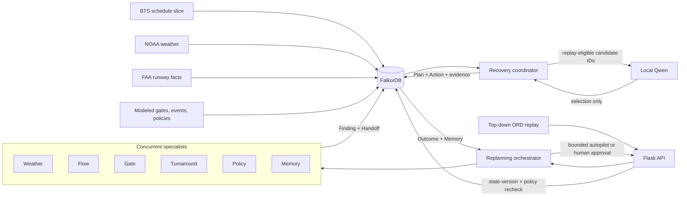

# Architecture

GroundGraph is a bounded airport-operations recovery command center. It borrows the situational-awareness and coordination pattern of an operations control center while remaining a historical replay: it does not issue clearances, control aircraft, or connect to operational airport systems.

## Runtime boundary

The judged path uses the official `docker.io/falkordb/falkordb:6.0.0` image through Podman. On hosts that use a Podman machine, `make start` creates or starts it with Podman's supported default provider. The command then starts FalkorDB, waits for the database health check, and launches the Python application in `FALKORDB_MODE=server`.

`make start-lite` is an explicit offline fallback built on FalkorDBLite. The API returns `runtime_mode`; screenshots and the demo should claim the official server only when `/api/health` returns `"runtime_mode": "server"`.

The local model runs through Ollama with `qwen3:4b-instruct`. The model receives only server-generated candidates and may return only one candidate ID. If Ollama is missing, slow, malformed, or selects an unknown ID, the coordinator uses the deterministic ranking among eligible candidates and labels the result `deterministic_fallback`.

## Replanning loop

The replay advances from 08:00 through 12:00 CST. A planning cycle runs:

1. when a material event becomes visible;
2. at each configured periodic checkpoint; and
3. immediately after a policy version changes.

Each cycle reads one current graph version, runs six specialist computations concurrently over that state, persists their findings and handoffs, constructs only policy-authorized candidates, asks the local model to select from those IDs, and writes a proposed plan. In bounded-autopilot mode, a current `APPLY_VALIDATED_PLAN` policy may authorize immediate application after deterministic replay checks. Supervised mode requires a human click. Both paths perform a fresh graph-version, current-policy, and `CURRENT_FOR_REPLAY` knowledge check before counterfactual state changes.

This design minimizes intervention without hiding authority: monitoring, impact discovery, coordination, ranking, replanning, and policy-authorized in-scope application can be automatic. The same runtime uses supervised mode when `GROUNDGRAPH_AUTO_APPLY=0`.

## MCP tool surface

`mcp_server.py` exposes five allowlisted stdio tools: `inspect_disruption`, `get_agent_handoffs`, `recall_episode`, `get_current_policy`, and `validate_candidate`. These tools return bounded graph evidence. They do not execute a plan; application stays behind the Flask API and the same graph-version, policy, knowledge, freeze, benefit, and churn checks used by the command center.

## Failure boundaries

- No FalkorDB connection in server mode makes the API unavailable; the interface cannot mutate or simulate operational state.
- A changed graph version makes an existing proposal stale.
- A missing current policy removes the affected action from the eligible candidate set.
- A failed local-model call activates a labeled deterministic fallback.
- All actions remain inside a six-flight, four-hour counterfactual replay.

