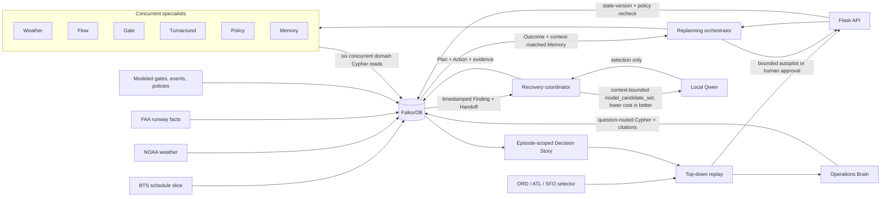

# Architecture

GroundGraph is a bounded airport-operations recovery command center with separate historical-demand replays for ORD, ATL, and SFO. It borrows the situational-awareness and coordination pattern of an operations control center: it does not issue clearances, control aircraft, or connect to operational airport systems.

## Runtime boundary

The full-server path uses the official `docker.io/falkordb/falkordb:6.0.0` image through Podman. On macOS, if no Podman machine exists, `make start` creates one with the AppleHV provider; it does not require Docker Desktop or Colima. If a machine already exists, the script starts the machine selected by Podman's default connection. The command validates the container image and loopback ports, requires both Redis `PONG` and the FalkorDB graph module, and then launches the Python application in `FALKORDB_MODE=server`.

`make start-lite` is an explicit offline fallback built on FalkorDBLite. The API returns `runtime_mode`; screenshots and the demo should claim the official server only when `/api/health` returns `"runtime_mode": "server"`.

The local model runs through Ollama with `qwen3:4b-instruct`. The server generates three materially different strategies: flow balance, compatible gate swap, and turnaround-task recovery. Each is a two-action bundle with benefit and operational burden derived from its FalkorDB neighborhood. The server removes ineligible and strictly dominated choices to compute the full lower-is-better `safe_candidate_set`. It then forms `model_candidate_set` from safe candidates whose `cost_score` is no more than 18 points above the safe-set leader for a `TURNAROUND` event class, or no more than 8 points above it for any other event class. The wider turnaround window lets Qwen compare a real operational tradeoff when all three options are graph-valid. Only those shortlist IDs enter `ModelRun.allowlisted_candidate_ids`; Qwen may return one of them. If Ollama is missing, slow, malformed, or selects an unknown ID, the coordinator uses the lowest-cost safe non-dominated candidate and labels the result `deterministic_fallback`.

Each scenario is a separate graph and engine instance: `groundgraph` for ORD, `groundgraph_atl` for ATL, and `groundgraph_sfo` for SFO under the default configuration. The API caches initialized engines, while `/api/airports/select` changes the active replay. This prevents state, decisions, or memory from one airport from being presented as evidence for another.

## Replanning loop

Each replay advances through its packaged four-hour local-time window: ORD 08:00–12:00 CST, ATL 14:00–18:00 EST, or SFO 13:00–17:00 PST. A planning cycle runs:

1. when a material event becomes visible;
2. at each configured periodic checkpoint; and
3. immediately after a policy version changes.

Each cycle fixes one input graph version. Weather, Flow, Gate, Turnaround, Policy, and Memory specialists then execute separate domain Cypher reads concurrently; the official-server path uses an independent database connection per worker. Every result records its query name, start and end timestamps, duration, evidence IDs, and input version. The coordinator begins only after all six `Finding` and `Handoff` records are in FalkorDB and marks those handoffs consumed by the decision episode.

The coordinator creates graph-valid actions and checks their required relationships: a flight must `USES` its runway, `COMPATIBLE_WITH` its proposed gate, a turnaround must hold a `MUST_COMPLETE_BEFORE` task dependency, and the inbound leg must `ROTATES_TO` the protected outbound leg. It then ranks the distinct candidates, computes the safe non-dominated ranking, applies the event-class cost window, invokes Qwen with only that shortlist, and persists the selected `Plan` and `Action` records. The visible causal path is queried only after those records exist, so every shown hop is an exact FalkorDB relationship such as `RECOVERED_BY`, `USES_RESOURCE`, `REORDERS`, `PROTECTS`, `AUTHORIZED_BY`, or `SUPPORTED_BY`.

In bounded-autopilot mode, a current `APPLY_VALIDATED_PLAN` policy may authorize immediate application after deterministic replay checks. The interface switch calls `POST /api/autonomy`, changes the server setting, and leaves a proposal pending in supervised mode. Manual and automatic paths both recompute the same seven checks before a counterfactual state change:

1. the proposal and specialist findings still use the current graph version;
2. every action still has current policy authority;
3. the supporting knowledge is still `CURRENT_FOR_REPLAY`;
4. every target and required FalkorDB relationship still exists;
5. no targeted outbound flight is inside the execution-freeze window;
6. projected recovery still clears the minimum-benefit threshold; and
7. the churn guard permits another intervention.

The browser reads `/api/decision-story` for one `DecisionEpisode` at a time. That graph-backed read model joins its trigger, affected entities, why-now timing, six findings, candidate set, `ModelRun`, application checks, outcome, and next checkpoint. Selecting an older decision therefore changes the whole story instead of combining an old handoff with the newest plan or outcome.

Successful application writes the complete `DecisionEpisode → Plan → Outcome ← Memory` lineage and retains the six unique `AgentRun → Finding → Handoff` chains consumed by that `DecisionEpisode`. Memory stores event class, connected flights, rotations, resources, policies, and a disruption signature. Later ranking uses only context-matched successful episodes, so a baggage-recovery memory cannot alter an unrelated weather decision. Reset reseeds the operational replay while restoring that applied episode, its same six specialist chains, selected plan, action relationships, outcome, and memory lineage. No persistence claim is made here for cycles that ended without an applied outcome.

Operations Brain routes a plain-language question to a bounded ownership, incident, current-policy, or supersession query. Its response includes an answer type, evidence IDs, the graph path used, and source citations. When the bounded company graph lacks support, it returns `INSUFFICIENT_EVIDENCE` instead of generating an answer.

This design minimizes intervention without hiding authority: monitoring, impact discovery, coordination, ranking, replanning, and policy-authorized in-scope application can be automatic. The same runtime uses supervised mode when `GROUNDGRAPH_AUTO_APPLY=0`.

## MCP tool surface

`mcp_server.py` exposes six allowlisted stdio tools: `inspect_disruption`, `get_agent_handoffs`, `get_coordinator_trace`, `recall_episode`, `get_current_policy`, and `validate_candidate`. Handoff and coordinator-trace tools are scoped to one `DecisionEpisode`: callers can pass its exact `episode_id`, while a cycle-only request deterministically resolves the newest episode for that cycle. This prevents records from separate replay generations with reused cycle numbers from being combined. These tools return bounded graph evidence. They do not execute a plan; application stays behind the Flask API and the same graph-version, policy, knowledge, freeze, benefit, and churn checks used by the command center.

The coordinator also persists its bounded inspection, policy lookup, contextual recall, and validation calls as `ToolCall` nodes linked from the active `DecisionEpisode`. This makes the model-facing evidence sequence inspectable without granting a tool permission to execute a plan.

## Failure boundaries

- No FalkorDB connection in server mode makes the API unavailable; the interface cannot mutate or simulate operational state.
- A changed graph version makes an existing proposal stale.
- A missing required operational edge makes the affected candidate ineligible.
- A missing current policy removes the affected action from the eligible candidate set.
- A failed local-model call activates a labeled deterministic fallback.
- An unmatched memory remains queryable but does not change ranking.
- All actions remain inside the active six-flight, four-hour counterfactual replay. Switching airports selects a different isolated graph; it does not turn the replay into live multi-airport control.

